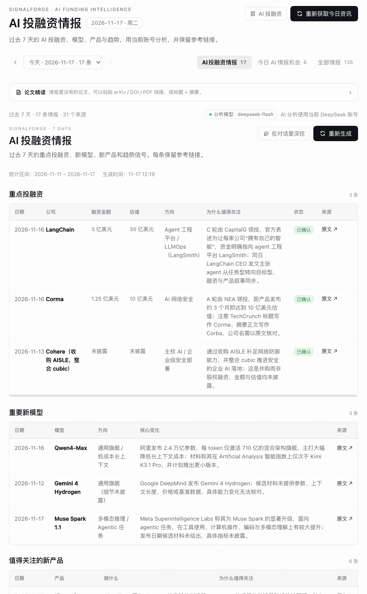
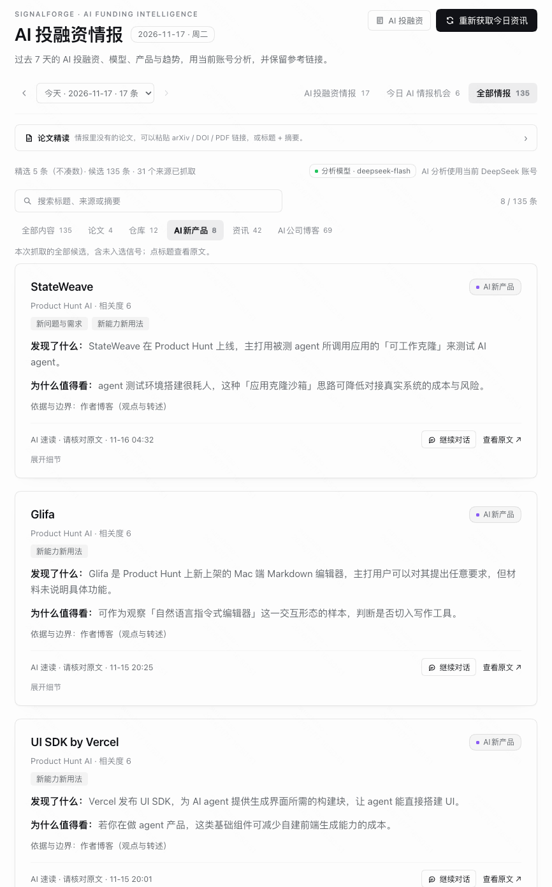
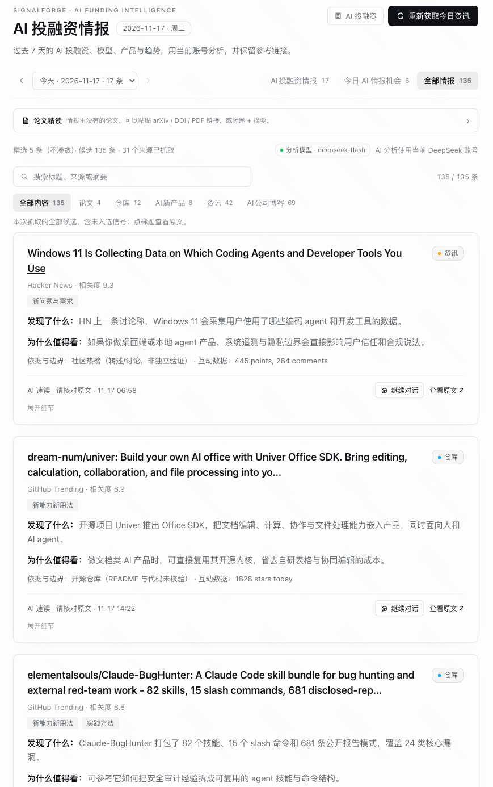
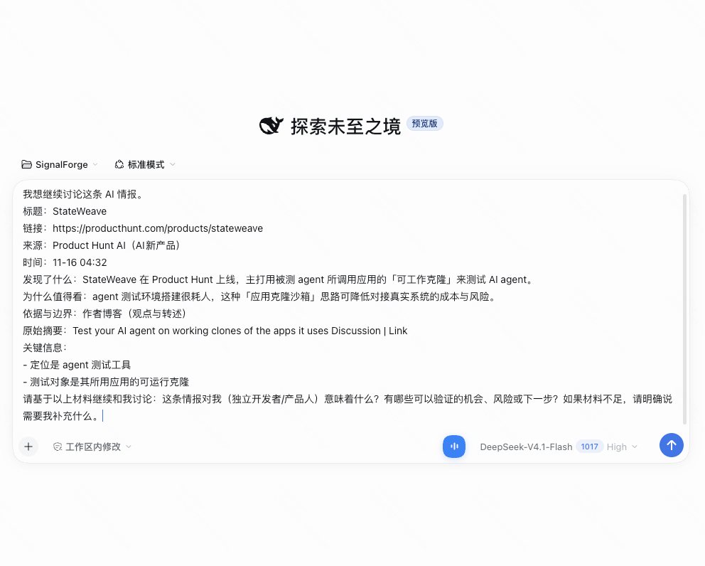

# SignalForge · AI 投融资情报

> 在 DeepSeek Harness 里生成过去 7 天的 AI 投融资情报：重点融资、新模型、新产品和趋势信号，每条都有参考链接。

这是一个社区插件，不是 DeepSeek 官方项目。适配 DeepSeek Harness `0.2.1-rc.5` / `0.2.x`，无需额外 API Key。

<p align="center">
  
</p>

## 为什么做这个

不是又一个 AI 新闻列表。

每天真正想知道的其实是四件事：

- 钱往哪走：谁拿了融资、金额和估值是多少、处于什么状态
- 模型变了什么：上下文、价格、速度、开放权重，而不是一句“更强了”
- 产品在做什么：哪些新产品真的在解决具体问题
- 这些事连起来说明什么：3–5 个有证据的趋势判断

所以第一栏被改成了一份 **过去 7 天的 AI 投融资情报**：先给结论表，再给来源链接。

## 界面速览

### 1）AI 投融资情报：三张表 + 趋势信号

过去 7 天的重点投融资、重要新模型、值得关注的新产品，以及 3–5 个趋势信号。

- 融资金额和估值分列，不把估值当融资额
- 状态标记「已确认 / 传闻 / 洽谈中 / 未说明」
- 每条保留「原文 ↗」来源链接
- 趋势信号必须带本周证据、so what 和反证/边界


### 2）AI新产品：Product Hunt 热榜

在「全部情报」的分类栏里新增 **AI新产品**。点一下只看 Product Hunt 的 AI 产品，当前抓到 8 个。

每个产品都有中文速读：发现了什么、为什么值得看、依据与边界；卡片上保留来源和发布时间。



### 3）全部情报：所有候选都保留

当天抓到的全部候选都在这里，包括没有进入报告的条目。

- 支持标题 / 来源 / 摘要搜索
- 按论文、仓库、模型、投融资、AI新产品、资讯、AI公司博客等分类筛选
- 每条都有中文速读，不是只给一个标题



### 4）继续对话：把情报带进 DeepSeek 对话

点卡片底部的 **继续对话**，会打开一个新的 Harness 对话，输入框里已经填好：

- 标题、原文链接、来源、时间
- 发现了什么、为什么值得看、依据与边界
- 原始摘要和关键信息
- 一段要求继续讨论「对独立开发者/产品人意味着什么、有哪些验证机会、风险或下一步」的提示词

它不会自动发送，你可以改完再发。



## 它能做什么

- **AI 投融资情报**：第一栏展示过去 7 天的重点投融资表、重要新模型表、值得关注的新产品表，以及 3–5 个趋势信号；每条都带来源链接，并区分已确认 / 传闻 / 洽谈中。
- **AI新产品**：全部情报里按 Product Hunt AI 热榜筛选，直接看新上架的 AI 产品。
- **今日 AI 情报机会**：从当天抓到的信号出发，生成商业机会和研发提效机会，包含触发点、产品形态、目标用户、MVP、风险或集成方式。
- **全部情报**：当天抓到的所有候选都保留，每条都有中文速读，可搜索、按分类筛选。
- **继续对话**：把标题、链接、来源、中文速读、依据与关键信息填进新的 Harness 对话。
- **论文精读**：论文卡片多一个「精读论文」按钮；顶部还有「论文精读」面板，可以粘贴情报之外的 arXiv / DOI / PDF 链接或标题 + 摘要。
- **在对话里深挖**：投融资情报右上角的「在对话里深挖」会打开新对话，使用 `ai-weekly-report` 技能继续联网检索。
- **按天保存**：每天一个 digest，日期下拉回看。
- **用当前账号分析**：不配置 `.env`，不保存 API Key，直接走 Harness 当前默认模型。

## 工作流

```text
32 个公开来源
  → 去重 / 排序 / 按来源分散
  → 7 天候选池
  → AI 整理为融资 / 模型 / 产品 / 趋势
  → 表格 + 来源链接
  → 存入当天 digest
```

报告只从抓到的候选里整理，不补写候选之外的公司、金额或产品；证据不足的栏目会留空。

## 发布素材

X / 小红书文案和配图在 [`docs/launch/`](docs/launch/)，包括报告、AI新产品、封面和竖版图。

## 安装

### 方式一：GitHub 源码（现在就能用）

```bash
dsh plugin --profile desktop add "github:sunstdot/signalforge-dsh"
```

插件没有构建步骤、没有运行时依赖，直接从 GitHub 安装即可。

### 方式二：GitHub Release 包（推荐，版本固定）

从 [Releases](https://github.com/sunstdot/signalforge-dsh/releases) 下载 `dsh-signalforge-<version>.tgz` 和 `SHA256SUMS`，校验后安装：

```bash
shasum -a 256 -c SHA256SUMS
dsh plugin --profile desktop add "$PWD/dsh-signalforge-0.2.4.tgz"
```

Linux 用 `sha256sum -c SHA256SUMS`。这种分发方式不依赖 npm，也不会在安装时执行构建。

### 方式三：npm（可选）

npm 不是 DSH 插件的必要条件，只是安装命令更短。如果包已经发布到公共 npm：

```bash
dsh plugin --profile desktop add dsh-signalforge
```

### 安装后

`dsh plugin add` 会安装包、写入当前 profile，并自动选中 bundle。**刷新一次 Harness 页面**（或重启应用），左侧出现雷达图标 **AI 投融资情报**。

如果 `dsh` 不在 `PATH` 里，用应用自带的启动器（macOS）：

```bash
/Applications/DeepSeek\ Harness.app/Contents/Resources/runtime/cli/bin/dsh
```

## 使用

1. 左侧打开 **AI 投融资情报**。
2. 点右上角 **AI 投融资**（或报告里的 **生成投融资情报**）。
3. 等待约 **1–2 分钟**：
   - 抓取过去 7 天的 32 个来源（含 15 个官方博客、TechCrunch Funding / Fundraising、Product Hunt AI）；
   - AI 只根据候选材料整理投融资、模型、产品和趋势；
   - 每条保留来源链接；
   - 保存为当天 digest。
4. 报告生成后，在 **AI 投融资情报 / 今日 AI 情报机会 / 全部情报** 三个标签间切换。
5. 想继续追问某条融资/模型/趋势，点报告右上角 **在对话里深挖**；会打开新对话并加载 `ai-weekly-report` 技能。
6. 如果还要跑当天的完整信号/机会/全部候选，点右上角 **重新获取今日资讯**；这条路径仍会抓 32 个来源并写全部中文速读。
7. 读论文时，论文卡片底部点 **精读论文**；情报之外的论文，点页面上方的 **论文精读** 面板，粘贴链接/标题摘要即可。
8. 用日期下拉回看历史。报告生成只对选中日期生效；历史日期可以按需重新生成报告。

一次完整生成会调用多次当前账号的模型。面板会显示阶段和批次进度。对于只有英文摘要的历史日期，打开后点 **补全中文速读**，只会补速读，不重跑精选和机会，避免重复消耗 token。

## 数据来源

每个来源独立超时、独立失败；单个源挂掉不会影响当天结果。

| 类型 | 来源 |
| --- | --- |
| 社区 | Hacker News 热榜、Hacker News Algolia 近 48 小时搜索 |
| 论文 | arXiv `cs.AI` / `cs.CL` / `cs.LG`、Hugging Face Daily Papers |
| 开源 | GitHub Trending（AI 关键词过滤） |
| 官方博客 | OpenAI、Google DeepMind、Google AI、Google Research、Hugging Face、Anthropic News、Anthropic Engineering、Cognition、Meta AI、NVIDIA Developer、Apple Machine Learning、LangChain、Cohere、Cloudflare AI、AWS Machine Learning |
| 投融资 / 产品 | TechCrunch Funding / Fundraising、Product Hunt AI |
| 媒体 / Newsletter | The Decoder、TechCrunch AI、The Verge AI、Latent Space、Smol AI News、Simon Willison、One Useful Thing、Import AI、Interconnects |

官方博客使用 14 天窗口，投融资/产品源使用 7 天窗口，其他新闻/社区 48 小时；这样周更博客和融资事件不会在安静的一天直接消失。

## 分类

「全部情报」使用这些分类：

- **论文**：arXiv、Hugging Face Daily Papers
- **仓库**：GitHub Trending
- **模型**：模型来源（有对应内容时出现）
- **投融资**：TechCrunch Funding 等融资来源
- **AI新产品**：Product Hunt AI 的最新热榜产品
- **资讯**：Hacker News、媒体、Newsletter、个人博客
- **AI公司博客**：OpenAI、Google DeepMind、Google AI、Google Research、Hugging Face、Anthropic、Cognition、Meta AI、NVIDIA、Apple ML、LangChain、Cohere、Cloudflare、AWS ML
- **微信公众号资讯**：微信公众号来源（有对应内容时出现）
- **Smol 资讯**：Smol AI News
- **投资者资讯**：投资者来源（有对应内容时出现）

## 数据与隐私

- 每天的完整结果保存在 `$DSH_HOME/signalforge/digests/YYYY-MM-DD.json`，索引在 `$DSH_HOME/signalforge/index.json`。
- 插件不读 `.env`、不保存 API Key、不走 SignalForge 的 FastAPI 后端。
- 分析通过 Harness 的 LLM 服务使用当前账号和默认模型；候选标题与摘要会发送给该模型。
- 抓取只访问上面列出的公开来源；没有埋点、没有遥测。
- Host API 位于本机 Harness Web 服务的 `/signalforge/api`，没有额外鉴权（与其他本机插件数据路由一致）；不要把 Harness 端口暴露到不可信网络。

## 配置

Bundle 默认值：

```yaml
- insert:
    - id: signalforge
      name: dsh-signalforge
      config:
        timezone: Asia/Shanghai
        maxSignals: 5
        lookbackHours: 48
```

在 profile 的 `cordis.patch.yml` 里可以覆盖：

```yaml
- id: signalforge
  name: dsh-signalforge
  config:
    timezone: Asia/Shanghai
    maxSignals: 8
    lookbackHours: 72
```

`maxSignals` 范围 1–8；`lookbackHours` 范围 6–168；也可以显式设置 `dataDir`。

## 开发

```bash
npm test          # 桩模型检查信号/机会与中文速读映射
npm run check     # 对全部 JS 文件执行 node --check
node scripts/probe.mjs              # 只跑抓取，检查来源覆盖
node scripts/test-client.mjs        # 客户端模块注册与首屏渲染
node scripts/test-chat.mjs          # 继续对话：文章信息与 startSession 调用
```

`node scripts/test-render-digest.mjs` 需要本地 `$DSH_HOME/signalforge` 里有真实 digest；`node scripts/backfill-items.mjs` 可以只补候选、不重跑模型。

目录：

```text
index.js                 Host：流水线、存储、/signalforge/api
client.js                Web 客户端：侧栏面板与三个标签
cordis.patch.yml         Bundle 默认配置
src/sources.js           32 个来源、HTML/RSS 采集、去重、排序、分类
src/analyze.js           信号/机会提示词 + 批量中文速读
src/paper-skill.js       paper-reading 技能：论文精读协议与输出契约
src/pipeline.js          完整任务与只补速读任务
src/store.js             每日 JSON + 索引
src/http.js              同源 JSON API
src/legacy.js            可选：导入旧 SignalForge 历史简报
```

发布步骤见 [PUBLISHING.md](PUBLISHING.md)。所有截图来自真实安装后的 Harness 页面，未合成 AI 回答。

## 已知边界

- 只支持获取当天；历史日期只读，可单独补中文速读。
- 没有定时任务；每天需要点一次。
- 第一期没有接入 X、Reddit、微信公众号公开账号（需要登录或稳定代理）；分类标签已预留。
- AI 输出是阅读辅助，不是事实核验。每张卡片都标注证据类型，请打开原文确认。
- 导入的历史日期速读按需生成，不会自动消耗 token。

## English

SignalForge brings daily AI intelligence into DeepSeek Harness. One click fetches today's AI sources, selects up to five signals, writes Chinese quick-reads for every candidate, and generates business and engineering opportunities — all through the signed-in DeepSeek account.

- Three tabs: selected signals, opportunities, and every candidate.
- Every card has **Discuss with AI**, which opens a new Harness conversation with the title, URL, Chinese quick-read, evidence, and details already in the composer.
- Paper cards add **Read paper**, which uses a registered `paper-reading` skill: classify the contribution, read out of order, separate assumptions, audit experiments, and decide adoption.
- A collapsible **Paper reader** panel accepts manual arXiv/DOI/PDF links or a title + abstract for papers outside the digest.
- **AI weekly** uses a registered `ai-weekly-report` skill and web search to research the last 7 days of funding, model releases, products, and trend signals.
- 32 login-free sources, including 15 official AI company blogs plus TechCrunch Funding and Product Hunt AI; a 7-day funding report with source links; paper/repo/model/funding/product/news categories.
- One digest per day under `$DSH_HOME/signalforge`.

Install from source:

```bash
dsh plugin --profile desktop add "github:sunstdot/signalforge-dsh"
```

Or download the `.tgz` from Releases. npm is optional. Refresh the Harness page after installation and open **AI 投融资情报** in the sidebar. See [PUBLISHING.md](PUBLISHING.md) for release details.

## License

MIT — see [LICENSE](LICENSE).
